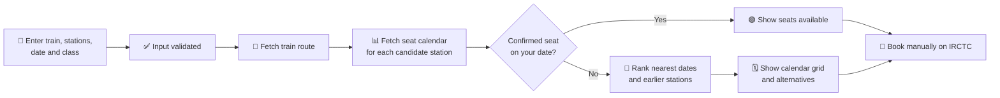
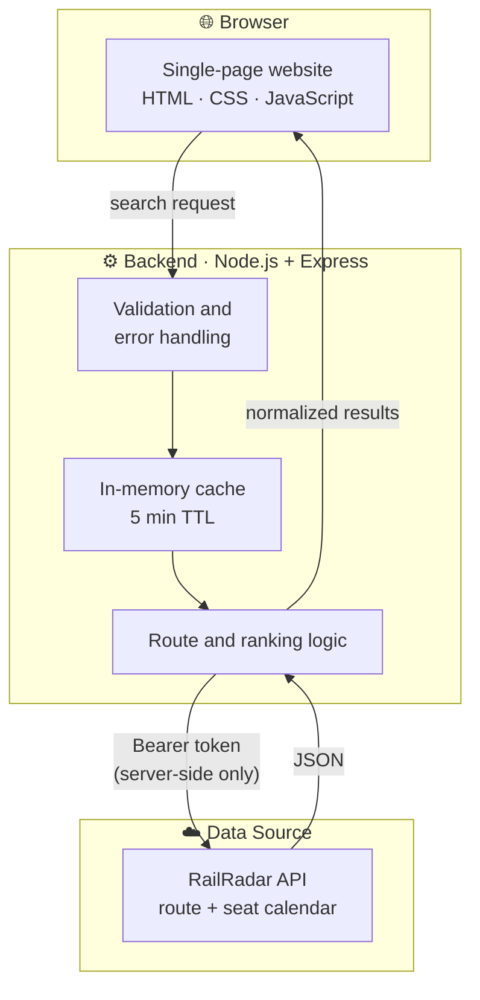

# 🚆 RailScout

### Find confirmed train seats, smarter.

When your Indian Railways ticket shows **waitlisted (WL)**, RailScout scans the rest of the route and the upcoming dates to show where a confirmed seat still exists.

 

**[🌐 Open the live app →](https://railscout.vercel.app/)**

---

## 📑 Table of Contents

- [The Problem](#-the-problem)
- [The Idea](#-the-idea)
- [Features](#-features)
- [How It Works](#-how-it-works)
- [Using the Live Site](#-using-the-live-site)
- [System Architecture](#-system-architecture)
- [Tech Stack](#-tech-stack)
- [API Reference](#-api-reference)
- [Engineering Decisions](#-engineering-decisions)
- [Legal and Ethical Boundary](#-legal-and-ethical-boundary)
- [Limitations](#-limitations)
- [Roadmap](#-roadmap)
- [Author](#-author)

---

## 🎯 The Problem

On Indian Railways, a seat that shows **WL** from your boarding station is often **confirmed** on the very same train in two other ways:

| Situation | What you see on IRCTC | What is actually true |
| :-- | :-- | :-- |
| Boarding mid-route | Waitlisted from your station | Seats are open from an **earlier station** on the same route |
| Travelling on a busy date | Waitlisted on your date | Seats are open on a **nearby date** |

Finding either by hand means searching IRCTC repeatedly, one station and one date at a time. It is slow, easy to get wrong, and stressful when you need to travel.

---

## 💡 The Idea

RailScout does that searching for you.

1. It checks **every upcoming date** for your route and class.
2. It scans **earlier stations** on the same train for confirmed berths.
3. It shows the results side by side, so you can decide quickly and book on IRCTC yourself.

> **Why both?** Plain availability checking already exists in the market. RailScout's focus is combining date scanning and station scanning in one view.

---

## ✨ Features

| | Feature | What it does |
| :-: | :-- | :-- |
| 🗺️ | **Smart Route Scan** | Checks availability from every station before your boarding point on the train's route |
| 📅 | **Daily Availability Grid** | Shows the upcoming dates in a colour-coded grid: **Available**, **RAC**, **Waitlist** |
| 📍 | **Nearest Confirmed** | Surfaces the closest station that has confirmed seats, to keep the detour small |
| ⏱️ | **Train Departure Awareness** | Marks stations the train has already left instead of showing a misleading status |
| 🧭 | **Clear Error Messages** | Explains problems in plain language: wrong direction, station not on route, date out of range, API down |
| 🔗 | **Book on IRCTC** | Opens IRCTC in a new tab so you complete the booking yourself |
| ⚡ | **Fast Repeat Searches** | Short-lived server cache avoids repeated API calls for the same route |

---

## 🔍 How It Works

**In short:**

1. You enter the train number, boarding station, destination, journey date and class.
2. The backend loads the train's ordered route and finds your boarding station on it.
3. It queries seat availability for the candidate stations before it. One response covers the full multi-day calendar for that route.
4. Results are ranked **nearest station first** and shown with clear status badges.
5. You open IRCTC from the page and book manually.

---

## 🖥️ Using the Live Site

Open **[railscout.vercel.app](https://railscout.vercel.app/)** and fill in the search form:

| Field | Example | Notes |
| :-- | :-- | :-- |
| Train Number | `12952` | 5-digit train code |
| Boarding Station | `KOTA` | Where you want to get on |
| Destination Station | `MMCT` | Where you want to get off |
| Journey Date | any date in the next ~14 days | Availability is only visible within this window |
| Travel Class | `3A` | `1A`, `2A`, `3A`, `SL`, `CC`, `2S` |

**Quick Test shortcuts** on the page pre-fill working examples:

| Train | Route |
| :-- | :-- |
| 12951 Rajdhani | KOTA → NDLS |
| 12301 Rajdhani | CNB → NDLS |
| 12952 Rajdhani | KOTA → MMCT |

**Reading the results**

| Badge | Meaning |
| :-- | :-- |
| 🟢 **Available** | Confirmed seats exist, with the seat count |
| 🟡 **RAC** | Reservation Against Cancellation, a shared berth |
| 🔴 **Waitlist** | Not confirmed, shown with the waitlist number |
| ⚪ **Unknown / Train Departed** | No usable data, or the train has already left that station |

---

## 🏗️ System Architecture

**Key points**

- The API key lives only on the server and is never exposed to the browser.
- There is **no database and no user accounts**. Nothing about the user is stored.
- The cache keeps repeated searches fast and protects the free API quota.

---

## 🧰 Tech Stack

| Layer | Technology | Why |
| :-- | :-- | :-- |
| **Frontend** | Plain HTML, CSS, JavaScript | One screen with a form and results; a framework would add weight without benefit |
| **Backend** | Node.js, Express, axios | Simple, fast to build, easy to explain end to end |
| **Data** | RailRadar API | Documented, structured JSON, a dedicated seats endpoint, free tier |
| **Caching** | In-memory (5 minute TTL) | No database needed for short-lived availability data |
| **Hosting** | Vercel | Public link, easy to share and demo |

---

## 📡 API Reference

RailScout exposes two read-only endpoints. All responses use a consistent shape: `{ success: true, ... }` on success or `{ success: false, error: { code, message } }` on failure.

### `GET /api/find-confirmed`

Scans earlier stations on the train's route for confirmed seats.

| Parameter | Required | Example |
| :-- | :-: | :-- |
| `trainNumber` | ✅ | `12952` |
| `boardingStation` | ✅ | `KOTA` |
| `destination` | ✅ | `MMCT` |
| `date` | ✅ | `2026-11-20` |
| `classCode` | ✅ | `3A` |

Returns candidate stations ranked nearest-first, each with its status, seat count or waitlist number.

### `GET /api/find-dates`

Returns the multi-day availability calendar for a route, with each date's status, weekday and seat or waitlist figure.

Takes the same parameters as above.

### Handled error cases

Missing or invalid parameters · train not found · station not on the route · wrong travel direction · date outside the forecast window · upstream API failure · rate limit reached · timeout.

---

## 🧠 Engineering Decisions

| Decision | Reasoning |
| :-- | :-- |
| **Third-party API instead of scraping IRCTC** | IRCTC has no public API. A documented API with its own terms avoids the legal and technical problems of scraping |
| **One seats call returns every date** | Scanning dates costs no extra requests, which matters on a free quota |
| **Cap on candidate stations** | Protects the monthly request limit while still covering the nearest, most useful stations |
| **Cache keyed by route and class, not date** | One cached response can serve every date for the same route |
| **Explicit "Train Departed" state** | Showing a clear reason beats a silent "Unknown" |
| **Website instead of browser extension** | An extension was a form in a small popup with no real browser integration. A website is easier to share and has room for the calendar grid |

---

## ⚖️ Legal and Ethical Boundary

RailScout is an **independent utility** powered by RailRadar data.

- ❌ It does **not** automate IRCTC
- ❌ It does **not** scrape IRCTC
- ❌ It does **not** book tickets or process payments
- ✅ Every booking is completed **manually by the user, directly on IRCTC**

This boundary is permanent. Automating ticket procurement is illegal under the Railways Act, and this project is built to stay well clear of it.

---

## ⚠️ Limitations

- Availability is visible for roughly the **next 14 days only**, which is the data provider's forecast window.
- Data is as accurate and as fresh as the RailRadar API. Always confirm the final status on IRCTC before paying.
- The free API tier has a monthly request limit.
- Booking on a different station or date than planned changes your journey. Check the boarding point and date on IRCTC before you book.

---

## 🗺️ Roadmap

- [x] Earlier-station scan for confirmed seats
- [x] Live website, deployed on Vercel
- [x] Multi-day availability grid
- [x] Clear, human-readable error handling
- [ ] Highlight the single nearest available date and weekday
- [ ] Show scheduled arrival and departure times on each station
- [ ] "Copy details" helper to speed up manual booking on IRCTC

---

**[🚀 Try RailScout live →](https://railscout.vercel.app/)**

RailScout is an independent project and is not affiliated with IRCTC or Indian Railways.

